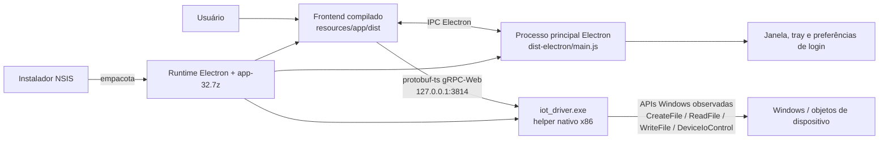

# Arquitetura observada do software Windows

Estado: inventário estático inicial da fase 1. Este mapa descreve componentes e fronteiras observadas, não o protocolo do teclado.

## Componentes observados

1. **Instalador NSIS**: contém o runtime e a aplicação. O arquivo `.exe` fornecido é o instalador, não o helper diretamente.
2. **Runtime Electron**: o pacote inclui `Attack Shark Driver v4.exe`, DLLs de Chromium/Electron e arquivos de recursos.
3. **Processo principal**: `dist-electron/main.js` configura janela sem moldura, tray, menu, ciclo de vida e canais IPC. Também acessa a preferência de inicialização no login.
4. **Interface**: bundle em `resources/app/dist`, com dependências React. O cliente protobuf-ts no bundle aponta para gRPC-Web no loopback `127.0.0.1:3814`; ele expõe chamadas para lista de dispositivos, leitura, escrita e limpeza/fechamento de dispositivo. São nomes/rotas do serviço local, não comandos USB decodificados.
5. **Helper nativo**: `iot_driver.exe`, PE x86, compilado provavelmente em Rust, importa primitivas de I/O de arquivo e controle de dispositivo do Windows. O bundle copia/abre uma versão do helper e a camada Electron usa a API local. A implementação USB e protocolo ainda não foram decompilados.
6. **Recursos**: imagens, fontes, estilos, chunks JavaScript e arquivos de idioma do Chromium.

## Limites das evidências

- A relação frontend → helper e o transporte gRPC-Web local foram observados no bundle; a relação interna helper → relatórios do K86 continua em investigação.
- Não há evidência observada de driver kernel, serviço instalado ou APIs HID nomeadas. A ausência na tabela de imports não exclui resolução dinâmica, APIs chamadas por outra DLL ou comunicação por um helper/driver.
- Os dados persistidos pela interface e as configurações que chegam ao teclado ainda são desconhecidos.
- Nenhum componente do fornecedor foi executado.
